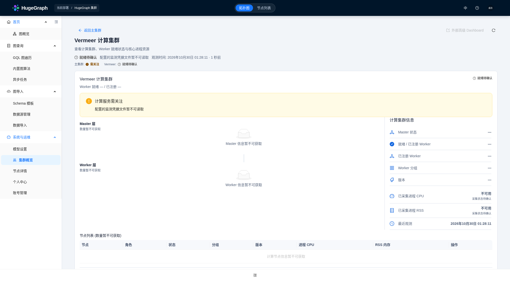

# Vermeer in Operations

The cluster overview keeps HugeGraph Server, PD and Store as the main topology.
When Vermeer health collection is configured, a separate compute-service summary
opens the compute view. Use **Back to main cluster** to restore the main view.
The compute topology places Master above Worker; Worker peers wrap within the
same layer as the deployment grows. Node details expose readiness checks and
process resource observations. Disabled integration does not occupy the default
main-cluster topology; an explicit compute-view URL still shows a neutral
not-deployed explanation.

Operations describes the current deployment. Its top bar does not filter nodes
by the graph or GraphSpace selected elsewhere in Hubble. Existing Operations
health, topology and metrics permissions also apply to Vermeer.

## Configure the backend

Configure these properties in `conf/hugegraph-hubble.properties`:

```properties
operations.vermeer.enabled=true
operations.vermeer.address=http://vermeer-master:6688
operations.vermeer.token_file=/var/run/hugegraph/vermeer/token
```

`address` is the operator-configured Master HTTP origin, including its actual
port. It must not contain credentials, a path or a query. Hubble contacts only
this Master; addresses returned for Workers are displayed as metadata and do
not become browser-side request targets.

The Operations keys are intentionally separate from the existing
`vermeer.url` and `vermeer.token_file` direct-analysis settings. Direct graph
analysis can use a narrower GraphSpace-scoped credential, while
`GET /api/v1/admin/cluster` requires an administrator credential in an
authenticated deployment. Operators may point both integrations at the same
Master, but should not copy a limited direct-analysis token into the Operations
setting. The HugeGraph Helm chart uses the same release-local Master and
administrator service token for both integrations because that token has the
required scope.

The Operations token file is read only by Hubble Backend and is never returned
in API responses. A deployment using anonymous Vermeer authentication may leave
`operations.vermeer.token_file` empty. Do not use a signing factor as a Bearer
token. The Helm chart mounts the generated token read-only into Hubble; signing
material remains outside the running Hubble container.

Vermeer is disabled by default. Disabled integration is a neutral state and
does not lower the main cluster's health. The Dashboard enable flag is not used
as a live health check.

## Backend contract

Hubble reads `GET /api/v1/admin/cluster` from the configured Vermeer Master.
This requires a paired Vermeer build providing schema version 1, including:

- Master and Worker identities, roles, versions and registration metadata;
- per-Worker reverse-connection and load, compute and superstep stream checks;
- registered and ready Worker counts;
- independently timestamped process CPU/RSS observations and metric availability.

Only the Vermeer Bearer exchange, including a continuously streaming response
body, is limited to `operations.connect_timeout_ms` plus
`operations.read_timeout_ms`. Existing PD, Store and readiness requests retain
their idle-read and source-specific deadline behavior. DNS validation precedes
the Vermeer HTTP call budget. Master and Worker raw IDs may overlap; the UI
includes the role in node-selection keys.

Concurrent explicit Vermeer refreshes share one in-flight collection. Network
and JSON parsing run outside the cache monitor, while an ordinary overview read
can return a fresh cached compute snapshot without waiting for that refresh.
Credential rotation starts a new generation; an older in-flight response cannot
overwrite the new credential's cache.

Each overview request still verifies the configured credential before using the
compute cache. Concurrent file reads share one bounded background read outside
the cache lock, with a caller wait limited by `operations.read_timeout_ms`.
An unreadable or stalled credential file produces `UNKNOWN` with reason
`vermeer_credentials_unavailable`, without cached compute nodes or resources.
A timed-out read cannot publish a late token; retries do not create additional
readers while the underlying file operation remains blocked. Cache expiry uses
monotonic elapsed time, independently of wall-clock adjustments.

`GET /api/v1.3/operations/overview` retains its existing `nodes`, `facts` and
`sources` for the main cluster and adds `vermeer`, `main_cluster_status` and
`main_cluster_reason`. The separate Vermeer object contains `configured`,
`availability`, `status`, `reason`, observation/freshness fields, Master and
Worker data, and readiness counts. Topology and metric fields are projected
according to the caller's existing Operations capabilities.

## Interpret the state

| Observation | Display |
| --- | --- |
| Connection and all required task streams are ready | Worker ready |
| Registered Worker has an incomplete connection or task stream | Worker not ready, with the failing check |
| No registered Worker | Compute service needs attention |
| Older Master has no cluster API | Readiness unavailable; upgrade the paired image |
| Monitoring credential file is unreadable or times out | Readiness and node counts unknown; no cached compute details |
| Master request fails after a successful observation | Current state unknown; previous evidence marked stale |
| CPU/RSS sampling fails while task streams remain ready | Worker remains ready; resources unavailable |
| Vermeer is disabled | No main-overview entry; direct links show Not deployed |

A configured Vermeer that needs attention can lower an otherwise healthy
deployment overview to **Attention**. The UI also shows the main cluster's own
status, so compute-service trouble does not claim that the graph database is
down. A space-scoped Worker availability result is not a global cluster health
verdict.

Worker counts mean **ready / registered**, not expected Helm replicas. A Worker
removed from the registration set is not invented as an offline historical
node. An unavailable registry is not an observed zero: the topology and node
list show unavailable counts, while a successfully observed empty registry
retains its zero-Worker explanation. Stale counts are labeled historical.
CPU is process CPU time divided by the sampling window, expressed in
cores; memory is process RSS, displayed in binary units. The compute information
panel sums each valid measurement from fresh samples, including partial
samples, and shows the collected-node coverage separately for CPU and RSS.
Upstream metric freshness flags remain effective even when the cluster snapshot
is fresh. Partial coverage is not a complete cluster resource total. These
observations are not host or Pod-limit percentages. The initial CPU observation
may report `metrics_warming_up`; wait at least one second and refresh for a
second sample.

When a failed refresh retains earlier evidence, the compute header, facts and
node details all show the last successful observation time. The failure reason
and stale marker make clear that current readiness is not confirmed.
Without a successful observation, the time remains unavailable; a failed probe
does not create a successful observation timestamp.

### Credential file unavailable



Actual Chromium capture with controlled API test data: unreadable credentials
clear earlier compute details, and unavailable counts do not imply zero Workers.
The main-cluster topology and the return action remain available. This image
does not establish live authentication or Helm deployment acceptance.

## Paired rollout

Build Hubble and Vermeer from the corresponding feature changes, then use the
new image references in the Helm release. The chart's existing immutable image
pins do not automatically refer to unpublished builds. Image publication and
`helm upgrade` are separate release actions; do not substitute an invented tag
or digest. Follow the chart's Vermeer deployment guide for its existing
standalone and distributed layouts.

The browser acceptance screenshots use controlled test responses because the
development workspace does not include a running Server/PD/Store deployment.
They demonstrate the UI interaction, not a live production cluster. The
Vermeer health API is additionally exercised against a local Master/Worker
pair with generated test credentials.
